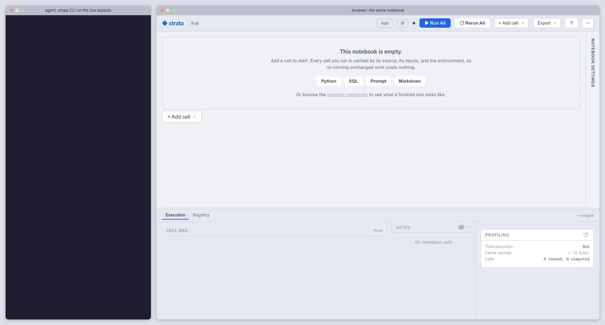

# Strata

[](https://pypi.org/project/strata-notebook/)
[](https://pypi.org/project/strata-notebook/)
[](https://github.com/bearing-research/strata/blob/main/LICENSE)
[](https://github.com/bearing-research/strata/actions/workflows/ci.yml)

**Strata is a notebook your coding agent can drive, and everything it computes stays.**

Coding agents explore by writing throwaway scripts: `python -c`, files in
`/tmp`, gone by the next session. Point one at Strata and the work lands in a
notebook instead. Every result is cached by what produced it, every cell
records who wrote it, and you can watch the whole thing in your browser while
the agent works.

<picture>
  <source media="(prefers-color-scheme: dark)" srcset="https://raw.githubusercontent.com/bearing-research/strata/main/docs/assets/web-agent-live-dark.gif">
  
</picture>

*An agent adds and runs cells through the `strata` CLI while the browser on the
same session updates. Captured from a real run, not a mock-up.*

## Try it

You need [uv](https://docs.astral.sh/uv/) 0.8 or newer and
[Claude Code](https://claude.com/claude-code) (or another MCP client).

```bash
uv tool install "strata-notebook[mcp,tui]"

strata agent ./my-notebook      # terminal 1: server, session and a live viewer
cd ./my-notebook && claude      # terminal 2: the agent drives the notebook
```

Ask the agent for an analysis and watch the cells arrive. Open
<http://localhost:8765> to follow along in the browser, or to take over and edit.

## Two ways an agent uses it

**The notebook is the deliverable.** `strata agent` scaffolds the notebook,
starts the server, and writes the `.mcp.json` and `CLAUDE.md` the agent needs.
You keep the result.
[Use a coding agent →](https://bearingresearch.com/strata/latest/notebook/agent/)

**The notebook is a scratchpad.** An agent working on something else runs its
throwaway Python in a cached cell instead of `python -c`, so the snippet from
ten turns ago is still there. Install the plugin once, in any Claude Code
session:

```
/plugin marketplace add bearing-research/strata
/plugin install strata-scratchpad@strata
```

[Agent scratchpad →](https://bearingresearch.com/strata/latest/notebook/scratchpad/)

Other agents connect to the MCP endpoint at `/mcp`, or script the `strata` CLI,
which returns JSON and stable exit codes.

## Why the work holds up

**Nothing runs twice.** A cell's identity is its source, its inputs and its
environment. The step an agent ran ten turns ago is a cache hit now, and an
edit re-runs only the cells below it.

```
First run:       load (2.5s) → summarize (0.4s) → plot (0.9s)  = 3.7s
Edit summarize:  load (✓)    → summarize (0.4s) → plot (0.6s)  = 1.0s
Run again:       load (✓)    → summarize (✓)    → plot (✓)     = <0.1s
```

That is a real run of the tutorial below, whose load step waits two seconds on purpose.

**You can review what it did.** Every cell records whether a person or an
agent wrote it. Watch live in the browser or with `strata watch` in a terminal,
or read the directory afterwards.

**It reads like code in git.** A notebook is one plain-text file per cell
(`.py`, `.sql`, `.md`, ...) plus a TOML manifest. Outputs and caches stay in a gitignored `.strata/` folder.

```
my-notebook/
├── notebook.toml      # cells, order, workers, mounts
├── pyproject.toml     # this notebook's own uv environment
├── uv.lock
└── cells/
    ├── 3f9a1c2e.py    # one file per cell
    └── 8b07d4aa.py
```

**Heavy cells go where the compute is.** `# @worker gpu-box` sends one cell to
another machine in the notebook's locked environment. Hand an agent an SSH
target and it provisions the worker itself.

**Whether agents use it is measured.** `evals/agent_notebook/` scores 9 recorded
agent sessions in CI, plus a group that checks whether an un-primed session
reaches for the notebook at all.

## For people, too

Run `strata-notebook` and open <http://localhost:8765> for the full editor:
Python, SQL, R, prompt and widget cells in one dependency graph, with an
interactive data viewer and a read-only app view.
[Notebook quickstart →](https://bearingresearch.com/strata/latest/getting-started/notebook/)

New here? `strata tutorial caching` opens a two-minute tour of what the cache saves.
`strata tutorial` lists the samples that ship with Strata, and **Open a sample** on the
home page does the same.

Coming from Jupyter? `strata import notebook.ipynb` converts a notebook.
Like marimo and Pluto, Strata builds the graph from variable references; unlike
them, every cell is cached by default and a single cell can run on another
machine. [How Strata compares →](https://bearingresearch.com/strata/latest/notebook/comparison/)

## Examples

| Example | What it shows |
| --- | --- |
| [agent_demo](https://bearingresearch.com/strata/latest/examples/agent_demo/) | A coding agent builds the notebook live; only the eval re-runs when the model caches |
| [pandas_basics](https://bearingresearch.com/strata/latest/examples/pandas_basics/) | A DataFrame pipeline: caching, staleness and per-cell tests |
| [review_triage](https://bearingresearch.com/strata/latest/examples/review_triage/) | A prompt cell with schema-validated LLM output |
| [arxiv_classifier](https://bearingresearch.com/strata/latest/examples/arxiv_classifier/) | One cell sent to a GPU worker |
| [r_lm_vs_sklearn](https://bearingresearch.com/strata/latest/examples/r_lm_vs_sklearn/) | R and Python sharing one graph over Arrow |
| [sql_orders_report](https://bearingresearch.com/strata/latest/examples/sql_orders_report/) | SQL, Python and markdown cells together |

[All examples →](https://bearingresearch.com/strata/latest/notebook/examples/)

## What is still moving

Materialization, the artifact store, the DAG, caching and headless runs are
settled and covered by tests. Three surfaces are not:

- **Prompt-cell API:** streaming and structured-output validation will change.
- **SQL cloud drivers:** DuckDB, SQLite and PostgreSQL run in CI. BigQuery and
  Snowflake ship without integration coverage.
- **On-disk formats:** `notebook.toml`, `.strata/runtime.json` and the cache
  layout may change between minor versions.

## Learn more

- [Documentation](https://bearingresearch.com/strata/latest/), including the full feature list
- [Installation](https://bearingresearch.com/strata/latest/getting-started/installation/): Docker, source builds, and why Strata needs uv
- [Use Strata as a library](https://bearingresearch.com/strata/latest/getting-started/core/) with `strata-client`
- [Deployment](https://bearingresearch.com/strata/latest/deployment/modes/): service mode, multi-tenancy, workers
- [Issues](https://github.com/bearing-research/strata/issues) for bugs and questions

## Development

```bash
uv sync --all-extras                   # install dependencies (matches CI)
uv run pytest                          # run the tests
uv run pre-commit run --all-files      # lint and format
cd frontend && npm run dev             # frontend dev server
```

## License

Apache 2.0
